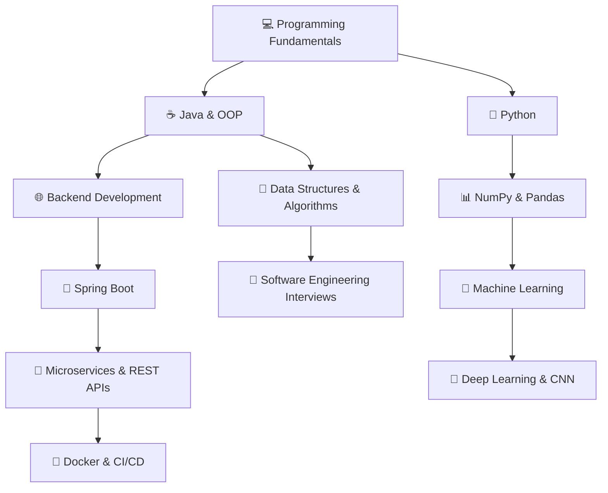
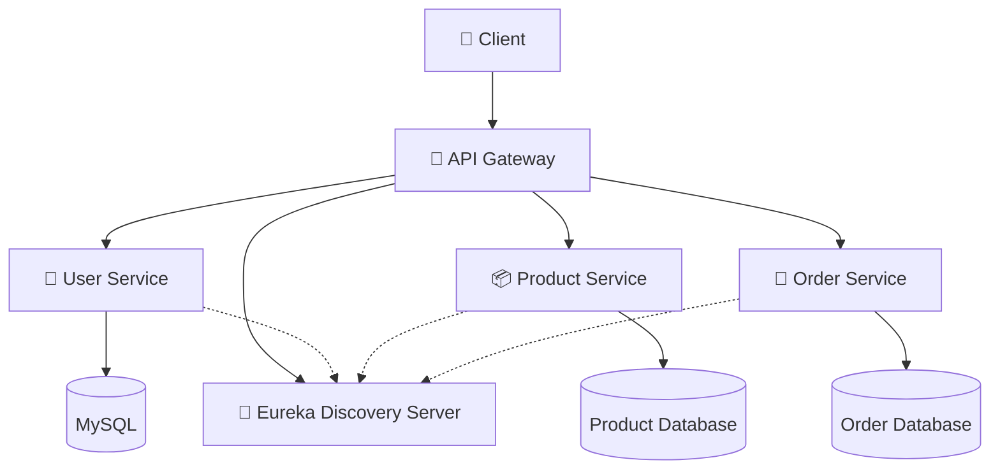
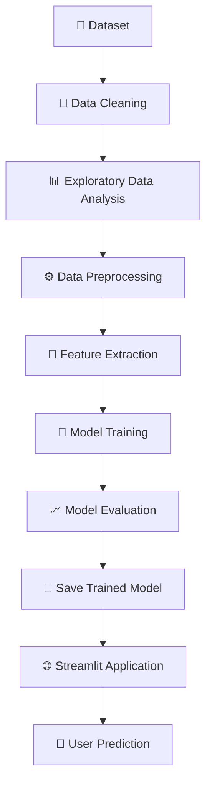

# 👋 Hey, I'm Masoom Imtiyaz!

<h3 align="center">💻 Java Developer | Backend Developer | AI/ML Enthusiast</h3>

  

  
  

---

## 🚀 About Me

- 🎓 Computer Science student passionate about software development.
- ☕ Working with Java and Spring Boot.
- 🧠 Practicing Data Structures and Algorithms.
- 🤖 Building Machine Learning and Deep Learning projects.
- 🔗 Exploring Microservices, REST APIs and System Design.
- 🌱 Continuously learning and building real-world applications.
- 🎯 Goal: Become a skilled Software Engineer.

---

## 🎯 Current Focus

| Area                 | Progress       |
| :------------------- | :------------- |
| 🧠 DSA – Striver A2Z | ▰▰▰▰▰▰▱▱▱▱ 60% |
| ☕ Java & Spring Boot | ▰▰▰▰▰▰▰▱▱▱ 70% |
| 🔗 Microservices     | ▰▰▰▰▰▰▱▱▱▱ 60% |
| 🤖 Machine Learning  | ▰▰▰▰▰▰▱▱▱▱ 60% |
| 🧠 Deep Learning     | ▰▰▰▰▱▱▱▱▱▱ 40% |
| 🐳 Docker & CI/CD    | ▰▰▰▱▱▱▱▱▱▱ 30% |

---

## 🛠️ Complete Tech Stack

### 💻 Programming Languages

  

### 🤖 AI / Machine Learning / Data Science

  
    
  
  
  
  
  

### 🔴 Backend Development

  
    
  
  
  
  

### 🌐 Web Development

  
    
  

### ⚙️ Developer Tools

  
    
  

---

## 📚 My Development Journey

---

## 🚀 Featured Projects

### 🎬 1. Movie Recommendation System

A content-based movie recommendation application that recommends similar movies based on movie information.

**Technologies:** Python, Pandas, Scikit-learn, TF-IDF, Cosine Similarity, Streamlit.

[🔗 Explore my GitHub repositories](https://github.com/Masoom7729?tab=repositories)

### 📧 2. Email Spam Classifier

A machine learning application that classifies messages as Spam or Ham using natural language processing.

**Technologies:** Python, NLP, TF-IDF, NLTK, Scikit-learn, Multinomial Naive Bayes, Streamlit.

[🔗 Explore my GitHub repositories](https://github.com/Masoom7729?tab=repositories)

### 🐶 3. Dog vs Cat Image Classifier

A deep learning project that uses a Convolutional Neural Network to classify dog and cat images.

**Technologies:** Python, TensorFlow, Keras, CNN, Google Colab.

[🔗 Explore my GitHub repositories](https://github.com/Masoom7729?tab=repositories)

### 🛒 4. E-Commerce Microservices

A backend application built using a microservices architecture, with separate services for users, products and orders.

**Technologies:** Java, Spring Boot, Eureka, API Gateway, JWT, MySQL.

[🔗 Explore my GitHub repositories](https://github.com/Masoom7729?tab=repositories)

---

## 🏗️ Project Architecture

### 🛒 E-Commerce Microservices Architecture

### 🤖 Machine Learning Project Workflow

---

## 📊 GitHub Analytics

---

## 📈 Contribution Activity Graph

---

## 🏆 GitHub Achievements

---

## 🐍 Contribution Snake

---

## 📋 Profile Summary Cards

---

## 🤝 Connect With Me

---

## 💛 Connect With Me

  

<h3 align="center">💙 Thanks for visiting my profile!</h3>

  <i>Keep Learning • Keep Building • Keep Growing 🚀</i>

